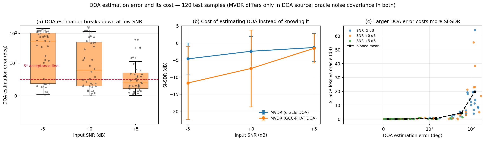
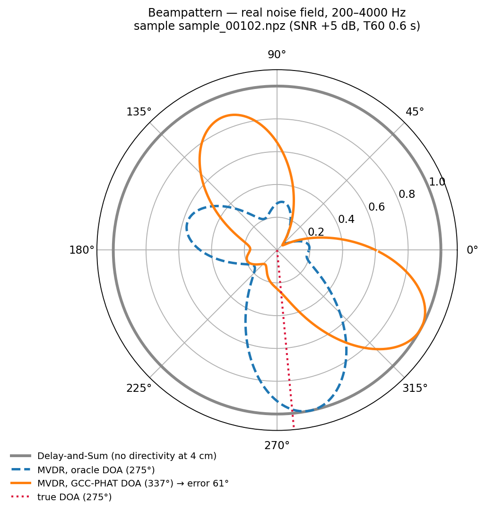

# neural-beamforming-speech-enhancement

A reproducible benchmark for **microphone-array speech enhancement**, comparing three
families on the same simulated array data: classical beamforming, neural beamforming,
and single-channel enhancement.

The point of the project is a controlled question: **how much does the array actually
buy you, and how much does it cost to estimate direction-of-arrival (DOA) instead of
knowing it?**

---

## Headline results

120 paired test utterances (20 utterances × 3 SNRs × 2 reverberation times),
4-mic circular array (radius 4 cm) at 16 kHz.

| Method | SI-SDR (dB) | STOI | PESQ-WB |
|---|---|---|---|
| Noisy (single channel) | −10.49 | 0.678 | 1.083 |
| Delay-and-Sum (oracle DOA) | −7.86 | 0.719 | 1.107 |
| MVDR (oracle DOA) | **−2.81** | **0.813** | **1.292** |
| MVDR (GCC-PHAT DOA) | −6.92 | 0.775 | 1.271 |
| mask-MVDR (oracle DOA) | −3.27 | 0.809 | 1.223 |
| mask-MVDR (GCC-PHAT DOA) | −10.71 | 0.715 | 1.185 |
| DCCRN-lite (single channel) | −9.51 | 0.691 | 1.191 |

Reproduce with `python eval.py --data data/sim/test --ckpt runs/w4/best.pt --dccrn runs/dccrn/best.pt --out results/final.csv`.
Metrics are computed with determinism enabled, so the table is bit-reproducible.

**Three things this table says:**

1. **The array is worth a lot.** The best array method beats single-channel `Noisy` by
   **7.7 dB** SI-SDR, and beats the best single-channel neural method (`DCCRN-lite`) by
   **6.7 dB**. Notably, `DCCRN-lite` is a 4.0 M-parameter complex-domain network and still
   loses to an MVDR beamformer that requires no training at all — spatial information is a
   dimension that a bigger single-channel network does not recover.
2. **Estimating DOA is not free.** `MVDR` loses **4.1 dB** going from oracle DOA to
   GCC-PHAT DOA. The figure below shows where that loss comes from.
3. **Mask-based MVDR does not beat oracle-noise MVDR — and it should not.** This is
   explained in [Two results that did not go as planned](#two-results-that-did-not-go-as-planned).
4. **`mask-MVDR` should not be used at low SNR.** Below roughly 0 dB it is worse than the
   unprocessed input. This is a real limitation of the method as implemented, quantified in
   [Known limitations](#known-limitations) — please read it before using this method.

---

## Where the DOA error hurts



**(a)** GCC-PHAT is accurate when the input is clean and collapses at low SNR.
**(b)** The resulting SI-SDR cost is negligible at high SNR and severe at low SNR.
**(c)** There is a threshold effect: below roughly 10° of DOA error the cost is
essentially zero; beyond it, the cost rises steeply.

| Input SNR | Median DOA error | SI-SDR cost vs oracle |
|---|---|---|
| +5 dB | 3.95° | **0.25 dB** |
| 0 dB | 7.75° | 5.04 dB |
| −5 dB | 54.79° | **7.06 dB** |

Overall, `corr(DOA error, SI-SDR loss) = 0.69` across the 120 samples.

Both `MVDR` variants share the *same* noise covariance (estimated from the ground-truth
noise observation) and differ **only** in the DOA source, so the difference is a clean
measurement of DOA estimation error alone.

## What a wrong DOA does to the beam pattern



The array is only 4 cm across, so at speech frequencies a delay-and-sum beamformer is
nearly omnidirectional (grey). MVDR with the true DOA forms a real main lobe at the
source direction (blue). With a DOA estimate that is off by 61°, the main lobe is
**steered to the wrong place** (orange) — this is the mechanism behind the 7 dB cost at
low SNR above.

---

## Methods

| Method | Trained? | Notes |
|---|---|---|
| Noisy | — | unprocessed single channel |
| Delay-and-Sum | no | classical, steered by a known/estimated DOA |
| MVDR | no | minimum variance distortionless response |
| mask-MVDR | yes | MVDR weights from a mask-weighted spatial covariance |
| DCCRN-lite | yes | complex-domain single-channel enhancement (control) |

Each of the three DOA-dependent methods is evaluated in two variants — **oracle DOA**
(true angle) and **GCC-PHAT DOA** (estimated from the observation) — so that the cost of
DOA estimation can be isolated from the cost of everything else.

**Metrics:** PESQ-WB, STOI, SI-SDR, on a paired grid of 3 SNRs (−5 / 0 / +5 dB) ×
2 reverberation times (T60 0.3 / 0.6 s). All samples within a condition share the same
room, source position, and noise realization, so comparisons are paired.

> **Why is SI-SDR negative?** The reference is the *dry* (anechoic) source signal, so
> reverberation counts as error — the metric reflects joint denoising and dereverberation.
> Absolute values being low is expected and honest; the information is in the *differences*
> between methods and in STOI/PESQ.

---

## Two results that did not go as planned

Both are kept in the repository rather than hidden, because diagnosing them was more
instructive than the parts that worked on the first try.

### 1. mask-MVDR loses to MVDR (oracle DOA) — this is expected, not a bug

The acceptance criterion originally written for this milestone was "mask-MVDR must beat
MVDR". It cannot, and the reason is structural: `MVDR (oracle DOA)` estimates its noise
covariance from the simulator's **ground-truth noise observation**, which amounts to
knowing the noise field for free. An estimate-versus-truth comparison is not a fair
fight, and no amount of tuning changes that.

This was verified rather than assumed: 36 configurations were swept (mask exponent ×
diagonal loading × MVDR/GEVD mode × whether the speech covariance is used). MVDR won
in **9 out of 9** loadings, with a stable margin of −0.18 to −0.25 dB. Separately, the
mask quality was shown to be near its ceiling — substituting the *ideal* ratio mask
improves mask-MVDR by only 0.163 dB.

The fair opponent is `MVDR (GCC-PHAT DOA)`, which estimates DOA from the observation
too. That comparison is in the table above.

### 2. DCCRN-lite was 10 dB worse than doing nothing — a train/inference length mismatch

The first evaluation of DCCRN-lite produced SI-SDR **−19.47 dB**, against −10.49 dB for
the unprocessed input: only 14 of 120 samples were improved. Training loss had looked
perfectly healthy (validation loss fell smoothly from 0.000923 to 0.000597), so nothing
pointed at the model itself.

The cause was the **inference sequence length**. The model was trained on 1-second
segments (126 STFT frames) but evaluated on full 4-second utterances (501 frames), and
the LSTM bottleneck is sensitive to sequence length. Holding the checkpoint fixed and
changing only how inference is chunked:

| Inference strategy | SI-SDR median | SI-SDR mean | STOI median | Better than input |
|---|---|---|---|---|
| Whole 4 s in one forward pass | −18.73 | −19.47 | 0.651 | 14/120 |
| Chunked to 126 frames | −9.06 | −9.51 | 0.686 | 80/120 |
| Split into four 1 s pieces | −9.03 | −9.40 | 0.682 | 80/120 |

The two chunking strategies agree closely, confirming the model was fine and the
*length* was the problem — a **10 dB** effect with no trace in the training curves.

Fixed by chunking inference to the training length. The training script now writes
`segment_length` into the checkpoint, inference reads it back, and a checkpoint without
that field raises a warning instead of silently using the wrong length.

After the fix DCCRN-lite beats `Noisy` on all three metrics (PESQ 1.083 → 1.191,
STOI 0.678 → 0.691, SI-SDR −10.49 → −9.51 dB).

---

## Known limitations

### mask-MVDR becomes worse than doing nothing at low SNR

This is the most consequential limitation in the project, and it is **not fixed** — it is
documented so that it is not mistaken for a working method.

Mean SI-SDR by input SNR:

| Input SNR | Noisy | MVDR (GCC-PHAT) | mask-MVDR (GCC-PHAT) | Mask compounding penalty |
|---|---|---|---|---|
| +5 dB | −7.81 | −1.59 | −2.74 | −1.15 dB |
| 0 dB | −10.04 | −7.47 | **−10.58** | −3.11 dB |
| −5 dB | −13.63 | −11.70 | **−18.81** | **−7.11 dB** |

At 0 dB and −5 dB, `mask-MVDR (GCC-PHAT)` is **worse than the unprocessed input**. The
worst single condition (SNR −5 dB, T60 0.6 s) reaches −19.81 dB against −15.62 dB for
`Noisy`. Only at +5 dB does it clearly help.

The last column is the diagnostic that matters: it is the gap between mask-MVDR and plain
MVDR **at the same DOA estimate**, so it isolates the effect of the mask. That penalty
grows from −1.15 dB at +5 dB to −7.11 dB at −5 dB. In other words, **mask estimation error
and DOA estimation error do not act independently — they compound**, and the compounding
gets worse exactly where the mask is least reliable.

The mechanism is consistent with the DOA analysis above: at low SNR the GCC-PHAT estimate
is often tens of degrees off (median 54.8° at −5 dB). A mask-weighted covariance estimated
from that same low-SNR observation is itself noisy, so the MVDR weights are built from a
mis-steered array *and* a poorly conditioned covariance. The failure is not graceful.

**What would plausibly fix it** (untested, listed for completeness):

- temporal smoothing or multi-frame joint DOA estimation instead of a single full-utterance
  estimate, so a few bad frames cannot dominate
- tracking the DOA and holding the last confident estimate when the current frame's
  confidence is low, rather than trusting every estimate
- restricting the mask to a trusted time-frequency region, or falling back to plain MVDR
  when an SNR/confidence criterion is not met

**Practical implication:** this method should not be used at low SNR without a
confidence-based fallback. `MVDR (GCC-PHAT)` degrades far more gracefully and is the
better choice below roughly 0 dB.

### Other limitations

- **Mask-MVDR uses ground-truth noise covariance.** The comparison against
  `MVDR (oracle DOA)` is not a fair one (see above). A fully fair evaluation would estimate
  the noise covariance from the mask as well — that variant is not implemented.
- **Simulated data only.** No real array recordings; the conclusions hold for the
  image-source model used here, with a 4 cm circular array and speech-shaped noise.
- **DOA estimation is single-source.** The estimator assumes one dominant source; it is not
  evaluated with concurrent talkers or moving sources.
- **The array is small (4 cm radius).** At speech frequencies this gives limited
  directivity even for MVDR (visible in the beampattern above), so the absolute gains are
  not representative of larger arrays.


---

## Why simulated data?

Room impulse responses are simulated with `pyroomacoustics` (image-source method)
rather than using real array recordings, because:

1. **Controllability.** Source direction, T60, and SNR are all exactly known, which makes
   strict ablations possible (oracle vs estimated DOA, per-condition breakdowns). Real
   recordings do not allow this.
2. **It is standard practice** in the beamforming literature.
3. **A clean reference is required** to compute PESQ/STOI, and real recordings rarely
   provide one.

Real-recording datasets (CHiME, L3DAS) are out of scope.

A subtlety worth noting: the dry reference is aligned to the array-center direct-path
delay, recovered from the RIR peak tap. `pyroomacoustics` RIRs carry a
distance-independent group delay of about 40 samples; if this is not removed, every
metric is silently wrong. Noise is also propagated through the RIRs so that it forms a
**spatially coherent** field — adding independent white noise per channel would make
beamforming look artificially effective.

---

## Quick start

**One command** (idempotent — existing artifacts are skipped, so a failed run can be
resumed by re-running it):

```bash
python scripts/reproduce.py all      # download -> generate -> train -> evaluate -> figures
python scripts/reproduce.py --smoke  # end-to-end self-check on tiny data (minutes)
```

`--smoke` exercises every stage at small scale to verify the pipeline itself. It is
**not** a source of reportable numbers — the tables above come from a full `all` run.

**Manual steps**, if you prefer to run them individually:

**GPU note:** RTX 50-series (Blackwell, sm_120) needs a CUDA 12.8+ build of PyTorch and
`torch >= 2.7`.

```bash
pip install torch torchaudio --index-url https://download.pytorch.org/whl/cu128
pip install -r requirements.txt

# verify GPU
python -c "import torch; print(torch.version.cuda, torch.cuda.is_available())"   # -> 12.8 True
```

```bash
# 1) download corpora (~950 MB, idempotent)
python scripts/download_data.py

# 2) generate multi-channel samples
python scripts/generate_dataset.py --split train --n 3000 --jobs 8
python scripts/generate_dataset.py --split val   --n 120  --jobs 8

# 3) paired evaluation grid (same utterances, rooms and noise across conditions)
python scripts/generate_dataset.py --split test --grid --n-utterances 20 \
    --snr -5 0 5 --t60 0.3 0.6 --jobs 8

# 4) train
python train.py        --data data/sim/train --val data/sim/val          # mask predictor
python train_dccrn.py  --data data/sim/train --val data/sim/val          # single-channel

# 5) evaluate -> results table
python eval.py --data data/sim/test \
    --ckpt runs/w4/best.pt --dccrn runs/dccrn/best.pt --out results/final.csv

# 6) regenerate figures
python scripts/make_figures.py all

# tests (265 of them)
python -m pytest tests/ -q
```

Smoke-test the whole evaluation in seconds with `--limit 2`.

### Data generation throughput

Room simulation is CPU-bound. Measured on an RTX 5070 Ti Laptop + Intel Ultra 7 255HX
(20 logical cores):

| Configuration | Throughput | |
|---|---|---|
| default | ~27 samples/s | `max_order_cap: 30` + `--jobs 8` |
| serial | ~6–7 samples/s | same, `--jobs 1` — 3.8× slower |
| full simulation | — | `max_order_cap: null`, 2.1 s/sample worst case |

Two independent optimizations, together roughly 15–20× faster than full simulation run
serially:

- **`--jobs N`** parallelizes room rendering across processes (8 workers → 3.81×).
  The job list is still generated in the parent process from one seed and results are
  collected in order, so output is **bit-identical** to the serial path (regression-tested).
- **`room.max_order_cap: 30`** caps the image-source order, which `inverse_sabine`
  drives steeply upward for large rooms with long T60 (median 52, max 114 measured),
  while cost grows super-linearly in order (correlation 0.927). High-order images carry
  negligible energy: at a cap of 30 the RIR retains 99.94% of its energy with 1.9%
  relative error, and SNR calibration, inter-channel coherence, and DRR are all unchanged.

> The cap is part of the RIR cache filename, so changing it invalidates stale caches
> instead of silently mixing RIRs computed under different settings.

---

## Repository layout

```
nbse/                  source (tracked)
  data/                room simulation, corpus loading, batch generation (no torch)
  beamformers/         DS / MVDR / mask-MVDR / GCC-PHAT DOA + geometry
  models/              CRN, DCCRN-lite, dataset wrappers (torch isolated here)
  metrics/             PESQ / STOI / SI-SDR
  dsp.py               STFT / ISTFT
  evaluate.py          evaluation logic
  training.py          training loop, losses, checkpointing
  determinism.py       bit-reproducible evaluation
configs/default.yaml   all simulation and training parameters
scripts/               data download, sample generation, figures, one-command reproduction
tests/                 265 tests
train.py               multi-channel CRN training entry point
train_dccrn.py         single-channel DCCRN-lite training entry point
eval.py                evaluation entry point -> results tables
results/               result tables (tracked)
docs/figures/          figures (tracked)
data/  rirs/  runs/    datasets, RIR cache, training artifacts (not tracked)
```

---

## Engineering notes

**Reproducibility.** GPU evaluation is bit-reproducible only with determinism explicitly
enabled: with default cuDNN, eight consecutive forward passes on the same input produced
eight different outputs (max diff 1.6e-05), which after covariance estimation and matrix
inversion became a **0.78 relative difference in beamforming weights** — enough to flip
the conclusion of a comparison. `nbse/determinism.py` enables
`torch.use_deterministic_algorithms` plus deterministic cuDNN at a cost of about 7%
(1.5 → 1.6 ms/batch) and is on by default for evaluation.

**A silent failure mode worth knowing about.** When an `nn.Module` is constructed lazily
during the first forward pass and the optimizer was built earlier, its parameters never
enter `optimizer.param_groups` — they stay at their initial values **with no error
raised**. DCCRN-lite's LSTM bottleneck has an input size that depends on the input shape,
so it is built in `__init__` via a dummy forward, and a test asserts that the optimizer
covers every parameter.

**Measurements are pipelined, not guessed at.** Two of the bugs found in the GCC-PHAT
implementation were sign errors invisible in the output statistics: the cross-correlation
product was written in the wrong order (recovering `r[−k]`, so a true lag of −3.7 samples
was reported as +3.72), and the FFT length was taken as `≥2N` instead of `≥2N−1`, which
wraps the tail of the linear correlation onto the front and produced spurious peaks (a
16-sample delay reported as −0.94). Both were pinned down by comparing against an
independent implementation rather than by reasoning. PHAT whitening must also be
band-limited: whitening across the full 0–8 kHz range where speech has no energy let
noise dominate the correlation, degrading median DOA error from 7.1° to 61.5°.

---

## Documentation

- Design: `docs/superpowers/specs/2026-10-09-neural-beamforming-design.md`
- Implementation plan: `docs/superpowers/plans/2026-10-09-neural-beamforming-plan.md`

## License

MIT
